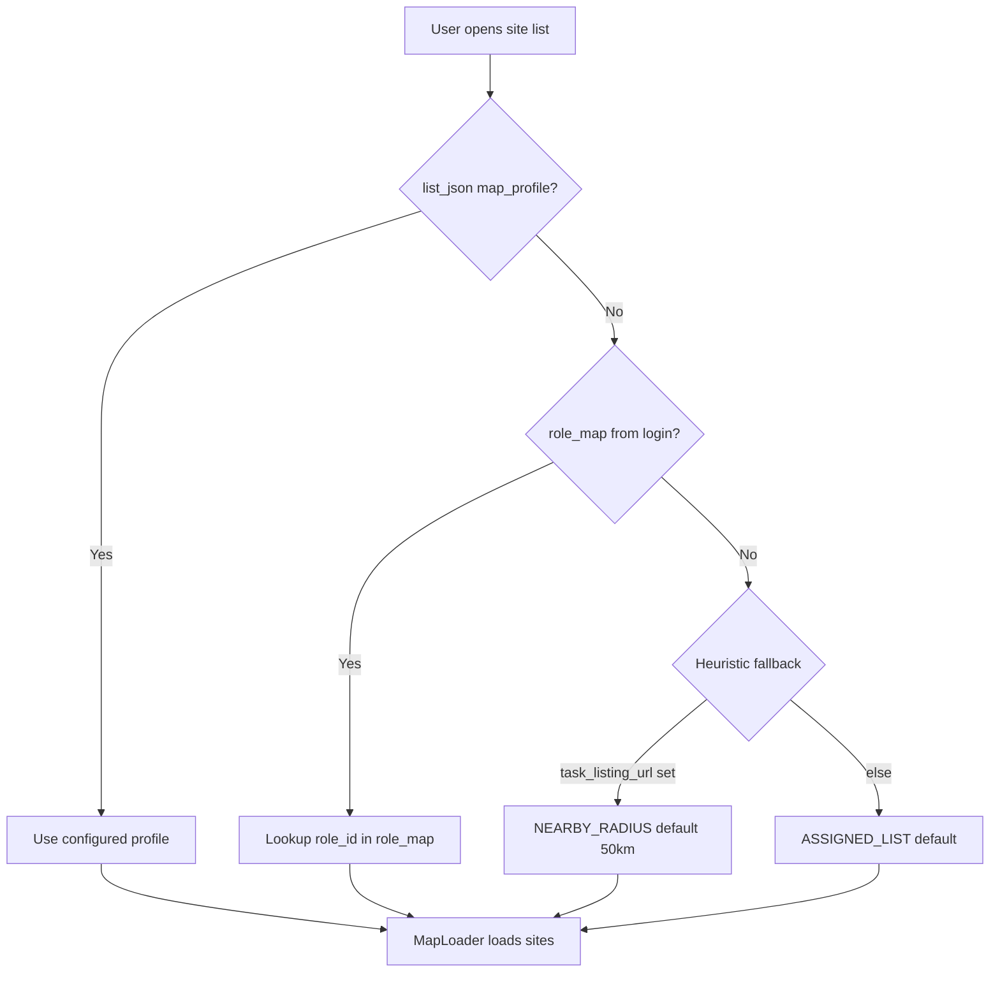

# Product Requirements Document (PRD) v2.0

## Universal Trip & Site Map (Read-Only UI Layer)

| Field | Value |
|---|---|
| **Version** | 2.0 |
| **Date** | 11 Aug 2026 |
| **Change from v1** | All roles supported via config profiles; strict module isolation |
| **Constraint** | **No changes to existing tracking engine** |

---

## 1. Executive summary

Build a **universal, read-only map module** that any role can use. Site loading, filters, and limits are driven by **server/UDF configuration** (`map_profile`), not hardcoded role IDs.

Examples (config, not code):

- VT → nearby sites within 50 km  
- CE → today's cluster sites (max 200)  
- PM / supervisor / auditor → assigned list, date range, or geofence sites  
- Any future role → new profile in config, **no app redeploy** for rule changes  

The module lives in **isolated packages/paths** with **thin integration hooks** so existing listing, trip, and tracking code stays untouched.

---

## 2. Design principles

| Principle | Meaning |
|---|---|
| **Engine sacred** | Never modify GPS, trip lifecycle, violations, upload, auto-stop |
| **Config over code** | Role behaviour = `map_profile` JSON, not `if (role_id === 364)` |
| **Read-only data** | Map only SELECTs / listens; never INSERTs into `track_master` or `lat_plug` |
| **One integration surface** | Single Cordova plugin + one JS module entry API |
| **Additive only** | New files/folders; existing files get minimal hooks (≤ 5 lines each) |
| **Fail safe** | If config missing → map hidden or `DEFAULT` profile; no crashes in list/trip flows |

---

## 3. Goals & non-goals

### 3.1 Goals

| # | Goal |
|---|---|
| G1 | **Any role** can have a map when `map_profile` is configured |
| G2 | Dynamic sites by **location, cluster, date, status, limit** per profile |
| G3 | **Planned route** to selected site + **covered route** from `track_master` |
| G4 | **Zero impact** on existing trip tracking engine |
| G5 | **Isolated codebase** — easy to disable, test, and remove |

### 3.2 Non-goals

- Turn-by-turn navigation  
- Engine / GPS / violation changes  
- Replacing existing map screens (`navigation`, `TripBackgroundMapActivity`) in v1 — they may coexist  
- Hardcoding role IDs 364, 305, etc. in Java/JS  

---

## 4. Universal map profile system

### 4.1 Profile resolution (priority order)



| Priority | Source | Example |
|---|---|---|
| 1 | `list_json[0].map_profile` | Full profile object on flow |
| 2 | `list_json[0].role_map` | `{ "364": {...}, "305": {...}, "*": {...} }` |
| 3 | Login `company_map_config` (optional future) | Tenant-wide defaults |
| 4 | Heuristic fallback | `task_listing_url` → `NEARBY_RADIUS`; else `ASSIGNED_LIST` |
| 5 | None | **Hide map button** |

### 4.2 Profile types (extensible registry)

| Profile type | Use case | Key params |
|---|---|---|
| `NEARBY_RADIUS` | Field techs, VT, roaming roles | `radius_km`, `site_limit`, `data_source` |
| `ASSIGNED_CLUSTER_TODAY` | CE, circle-bound day plan | `cluster_field`, `date_filter: today`, `limit: 200` |
| `ASSIGNED_CLUSTER` | Cluster sites, any date | `cluster_field`, `date_filter`, `limit` |
| `ASSIGNED_LIST` | Standard PM / any role with task list | `limit`, `status_filter`, `use_cached_list: true` |
| `DATE_RANGE` | Auditors, planners | `start_date`, `end_date`, `limit` |
| `GEOFENCE_DOWNLOAD` | Sites from `geofence_tracking` table | `radius_km`, `limit` |
| `OFFLINE_TASK_MASTER` | Offline-first roles | SQLite query template |
| `CUSTOM_API` | Tenant-specific WCF | `api_url`, `param_template` |

### 4.3 Example configs

**VT-style (any role)**

```json
{
  "map_profile": {
    "type": "NEARBY_RADIUS",
    "radius_km": 50,
    "site_limit": 500,
    "data_source": "task_listing_url",
    "show_radius_circle": true
  }
}
```

**CE-style (any role)**

```json
{
  "map_profile": {
    "type": "ASSIGNED_CLUSTER_TODAY",
    "cluster_field": "circle_id",
    "date_field": "survey_date",
    "limit": 200,
    "data_source": "OnlineTaskListing",
    "marker_cluster": true
  }
}
```

**Generic PM (default for most roles)**

```json
{
  "map_profile": {
    "type": "ASSIGNED_LIST",
    "limit": 100,
    "use_cached_list": true,
    "data_source": "listing_cache"
  }
}
```

**Role map (one flow, many roles)**

```json
{
  "role_map": {
    "364": { "type": "NEARBY_RADIUS", "radius_km": 50, "site_limit": 500 },
    "305": { "type": "ASSIGNED_CLUSTER_TODAY", "limit": 200, "cluster_field": "circle_id" },
    "*":   { "type": "ASSIGNED_LIST", "limit": 100, "use_cached_list": true }
  }
}
```

`*` = default for any role not listed.

---

## 5. Role examples (config-driven, not code-driven)

| Role | Example ID | Profile | Behaviour |
|---|---|---|---|
| Vendor Technician | 364 | `NEARBY_RADIUS` 50 km | Nearby transport sites |
| CE | 305 | `ASSIGNED_CLUSTER_TODAY` | Today + cluster, max 200 |
| PM / field engineer | * | `ASSIGNED_LIST` | Current list on screen |
| Supervisor | * | `DATE_RANGE` or `ASSIGNED_LIST` | Team/date filtered (server) |
| Auditor | * | `ASSIGNED_CLUSTER` | Cluster, wider date |
| Offline user | * | `OFFLINE_TASK_MASTER` | Local SQLite tasks |

**No role ID checks in Java.** Only `MapProfileResolver` reads config.

---

## 6. Code organization (isolation)

### 6.1 Folder structure (new — do not mix into existing files)

```
EasyFormSE_finance/
├── src/com/sky/atc/easyformse/
│   └── trip/
│       └── mapui/                          # NEW isolated package
│           ├── VtTripTrackingMapActivity.java
│           ├── TripTrackingMapPlugin.java
│           ├── MapProfile.java             # POJO
│           ├── MapProfileResolver.java
│           ├── MapSiteLoader.java          # read-only site fetch
│           ├── TrackPathReader.java        # read-only track_master
│           ├── RouteOverlayHelper.java     # Directions (from navigation.java)
│           ├── MapBroadcastReceiver.java   # trip-background-map listener
│           └── MapConstants.java
│
├── assets/www2/
│   └── EFSE_Js/
│       └── trip_map/                       # NEW isolated JS module
│           ├── trip_map_entry.js           # single public API
│           ├── trip_map_profile.js         # resolve profile from list_json
│           ├── trip_map_cache.js           # sessionStorage normalize/cache
│           ├── trip_map_config.js          # defaults, profile registry
│           └── trip_map_hooks.js           # minimal hooks for list pages
│
└── docs/
    └── PRD-Trip-Site-Map.md                # this document
```

### 6.2 Integration hooks (only allowed touch points)

| Existing file | Allowed change | Max scope |
|---|---|---|
| `selection_survey.html` | Script include + map FAB/button | 3–5 lines |
| `viewsitelist_pm_on.js` | Call `TripMapCache.saveListing(sites)` after list load | 1 function call |
| `viewsitelist_pm.js` | Same cache hook (offline list) | 1 function call |
| `res/xml/config.xml` | Register `TripTrackingMapPlugin` | 1 feature block |
| `AndroidManifest.xml` | Register `VtTripTrackingMapActivity` | 1 activity |

### 6.3 Files that must NOT be modified

| Area | Files |
|---|---|
| GPS / tracking core | `newfused.java`, `loc_change.java`, `newfused_*.java` |
| Trip lifecycle | `TripPlugin.java`, `TripMapUi.java` (start/stop logic) |
| Auto-stop | `AutoTripStopService.java` |
| Violations | `SpeedViolation.java`, `activity_recognize.java` |
| Upload | `TripUploadNew.java`, `f_upload_new_structure.java` |
| Existing maps | `navigation.java`, `SiteRoutePlugin.java`, `TripBackgroundMapActivity.java` (v1) |

### 6.4 Feature flag (kill switch)

```json
{
  "trip_map_enabled": true
}
```

- In `list_json[0]` or company config  
- If `false` → no button, no plugin calls, zero UI impact  
- Allows disabling entire module without redeploying engine  

---

## 7. Architecture

```
┌──────────────────────────────────────────────────────────────┐
│  EXISTING (unchanged)                                         │
│  viewsitelist_*.js → listing APIs → site list UI              │
│  TripPlugin / newfused / track_master / upload                │
└───────────────────────────┬──────────────────────────────────┘
                            │ 1 hook: cache sites JSON
┌───────────────────────────▼──────────────────────────────────┐
│  NEW MODULE: trip_map/ (JS) + trip/mapui/ (Java)               │
│                                                               │
│  trip_map_entry.open()                                        │
│    → MapProfileResolver.resolve(list_json, role_id)           │
│    → TripMapCache.getSites() | MapSiteLoader.load(profile)    │
│    → TripTrackingMapPlugin.openMap(profile, sites, tripMeta)  │
│                                                               │
│  VtTripTrackingMapActivity                                    │
│    → markers (profile-driven filter already applied)          │
│    → TrackPathReader.read(tid)  [SELECT only]                 │
│    → RouteOverlayHelper.draw(user, site)  [network]           │
│    → MapBroadcastReceiver  [listen trip-background-map]       │
│    → NO FusedLocationProvider                                 │
└──────────────────────────────────────────────────────────────┘
```

### 7.1 Public JS API (single entry — rest is internal)

```javascript
// trip_map/trip_map_entry.js — only export used by existing pages
TripSiteMap.open();           // resolve profile + open map
TripSiteMap.cacheListing(data); // called from list load hook
TripSiteMap.isEnabled();      // feature flag + profile check
```

Existing pages never import internal files directly.

---

## 8. Functional requirements (all roles)

### 8.1 Map visibility

| ID | Requirement |
|---|---|
| FR-01 | Map button shown iff `trip_map_enabled !== false` AND resolved profile exists |
| FR-02 | Works for **any** `role_id` when `role_map` or `map_profile` configured |
| FR-03 | Default profile `ASSIGNED_LIST` when heuristic fallback applies (also true with *no* `map_profile`/`role_map`/`task_listing_url` at all — the heuristic's own final fallback, not a separate "no config" case) |
| FR-04 | **Superseded (2026-08-12).** As originally written this said "map hidden gracefully when no profile and no fallback" — but the heuristic (FR-03) never actually returns null, so that case cannot occur in the current implementation; the only ways the button is genuinely hidden are the explicit kill switch (`trip_map_enabled: false`) or a configured `type` that isn't in `TripMapConfig.IMPLEMENTED` (e.g. `CUSTOM_API`, `DATE_RANGE`-before-2026-08-12, a JSON parse failure). This was a deliberate later product decision, not an oversight: "allow the map to render even when nothing is nearby / no profile is configured" was explicitly requested mid-build, on the reasoning that a map explaining *why* it has nothing to show beats one that silently disappears. See `emptyPayloadMessage()` in `VtTripTrackingMapActivity.java` for the on-screen behavior this produces. |

### 8.2 Site loading (profile-driven)

| ID | Requirement |
|---|---|
| FR-10 | `MapSiteLoader` implements all profile types via strategy pattern |
| FR-11 | Prefer **cached listing** when `use_cached_list: true` (no duplicate API) |
| FR-12 | Validate coordinates; exclude null/0/fallback-user-lat |
| FR-13 | Apply `limit` after sort (distance / date / name per profile) |
| FR-14 | `NEARBY_RADIUS`: filter `distance <= radius_km * 1000` |
| FR-15 | `ASSIGNED_CLUSTER_*`: filter by `cluster_field` (default `circle_id` from login) |
| FR-16 | `ASSIGNED_CLUSTER_TODAY`: filter `date_field == today` (device or server TZ) |

### 8.3 Map display (same for all roles)

| ID | Requirement |
|---|---|
| FR-20 | User marker (existing GPS plugin, one-shot) |
| FR-21 | Site markers + cluster when `marker_cluster: true` |
| FR-22 | Tap site → bottom sheet (name, id, distance, status) |
| FR-23 | **Show route** → blue polyline (Directions, read-only) |
| FR-24 | If trip active: covered route from `track_master` (green; red/orange violations) |
| FR-25 | Refresh path every 45–60s; listen `trip-background-map` broadcast |
| FR-26 | **No** new GPS listener in map activity |

### 8.4 Profile-specific UI labels (configurable)

| Profile | Header label example |
|---|---|
| `NEARBY_RADIUS` | "{n} sites within {radius_km} km" |
| `ASSIGNED_CLUSTER_TODAY` | "{n} of {limit} today's sites" |
| `ASSIGNED_LIST` | "{n} sites on your list" |
| `DATE_RANGE` | "{n} sites ({start} – {end})" |

---

## 9. Data contract

### 9.1 Normalized site (internal)

```typescript
interface MapSite {
  site_id: string;
  site_name: string;
  lat: number;
  lon: number;
  status?: number;
  server_task_id?: string;
  survey_date?: string;
  cluster_id?: string;
  distance_m?: number;
  raw?: object;  // passthrough for "Open task" deep link
}
```

### 9.2 Session cache (isolated keys — no collision)

| Key | Purpose |
|---|---|
| `trip_map_sites_v1` | Normalized site array |
| `trip_map_profile_v1` | Resolved profile JSON |
| `trip_map_meta_v1` | `{ role_id, flow_id, cached_at }` |

**Prefix `trip_map_`** avoids clashing with `trip_status`, `trip_Array`, etc.

### 9.3 Plugin payload

```json
{
  "profile": { "type": "NEARBY_RADIUS", "radius_km": 50 },
  "sites": [ "..." ],
  "trip": { "active": true, "tid": "123", "min_milli": 1690000000 },
  "user": { "lat": 23.09, "lon": 77.50 }
}
```

---

## 10. Battery & performance (all roles)

| Rule | Value |
|---|---|
| No fused GPS in map | Mandatory |
| Path poll interval | 45–60 s |
| Site reload on map open | Once; refresh on user pull or > 2 km move (NEARBY only) |
| Max markers | Per profile `site_limit` (default 100) |
| Clustering | Required when `limit > 50` |

---

## 11. Coexistence with existing features

| Existing | Relationship |
|---|---|
| `TripBackgroundMapActivity` | Coexists; optional later deprecation |
| `SiteRoutePlugin` / `navigation` | Logic **copied** into `RouteOverlayHelper`; plugins unchanged |
| `selection_map.js` | Separate dashboard map; no merge in v1 |
| Per-row map icons in list | Unchanged |
| Geofence IN/OUT | Map may read `geofence_tracking` for `GEOFENCE_DOWNLOAD` profile only |

---

## 12. Testing strategy (module-isolated)

| Layer | Tests |
|---|---|
| `MapProfileResolver` | Unit: each profile type + role_map + fallbacks |
| `MapSiteLoader` | Unit: filter/limit/coordinate validation |
| `TrackPathReader` | Unit: mock SQLite read |
| Integration | Open map per profile; verify no trip/GPS side effects |
| Regression | Trip start/stop, upload, violations unchanged (diff guard on engine files) |

**CI rule:** PR fails if any file under `trip/mapui` engine blocklist is modified.

---

## 13. Phased delivery

| Phase | Scope | Roles |
|---|---|---|
| **P1** | Module scaffold + `ASSIGNED_LIST` + covered path | All roles (default) |
| **P2** | `NEARBY_RADIUS` + cache hook | VT + any radius role |
| **P3** | `ASSIGNED_CLUSTER_TODAY` + clustering | CE + cluster roles |
| **P4** | Planned route overlay + violation segments | All |
| **P5** | `role_map`, `GEOFENCE_DOWNLOAD`, `CUSTOM_API` | Tenant-specific |

Each phase is **additive files only** + optional one-line hooks.

---

## 14. Acceptance criteria

### 14.1 Isolation

- [ ] All new code under `trip/mapui/` and `EFSE_Js/trip_map/`
- [ ] Engine blocklist files have **zero diff** in PR
- [ ] `trip_map_enabled: false` hides feature completely
- [ ] Removing plugin registration disables map with no list/trip errors

### 14.2 All roles

- [ ] Role with `map_profile` → correct behaviour
- [ ] Role in `role_map` → correct behaviour
- [ ] Role with only `*` default → `ASSIGNED_LIST` from cache
- [x] Role with no config + no `task_listing_url` → `ASSIGNED_LIST` from cache, **not** hidden (see FR-04, superseded 2026-08-12)
- [ ] Role with `task_listing_url` only → `NEARBY_RADIUS` fallback

### 14.3 Functional

- [ ] Markers, planned route, covered path work for any profile that supplies sites
- [ ] No second GPS client when map open (battery check)

---

## 15. Open questions

| # | Question |
|---|---|
| OQ-1 | Ship `role_map` in `list_json` or separate download config? |
| OQ-2 | Tenant-wide `company_map_config` at login? |
| OQ-3 | "Open task" from map — deep link to existing click handlers per flow? |
| OQ-4 | Server `radius_km` on listing APIs for all tenants? |

---

## 16. Summary

| v1 (CE/VT only) | v2 (this document) |
|---|---|
| Hardcoded role 364 / 305 | **Any role** via `map_profile` / `role_map` |
| Logic in trip JS | **Isolated** `trip_map/` + `trip/mapui/` |
| Risk to engine | **Blocklist** + read-only + feature flag |
| Extension | New profile type = new loader strategy, no engine touch |

This feature is a **self-contained map product module**: configure per role on the server, integrate with **one cache hook** and **one map button**, and leave the tracking engine completely alone.
